<div align="center">



<br />

<a href="https://github.com/Rashmi-Pathak/portfolio-2">
  
</a>

<br />


<br />

### *I build intelligent products from data to deployment.*

[Live Selected Work](#-selected-work--the-16-volume-archive) · [Motion & 3D Engineering](#-motion-3d--interactive-systems) · [Architecture](#-architecture--routes) · [Local Setup](#-local-development) · [Connect](#-connect)

</div>

---

## ⚡ Editorial Concept & Craft

Designed in an **art-book / manga editorial** aesthetic — warm ivory paper (`#EFE8D8`), ink black (`#11100F`), warm charcoal (`#211C18`), crimson accents (`#B51F2B`), subtle halftone fields, and oversized condensed display typography.

- **4 Live Ink Swatches**: Switch between Crimson, Terracotta, Cobalt, and Forest themes in real time from the top navigation.
- **Accessible Motion Control**: Persistent `MOTION ON/OFF` toggle paired with `prefers-reduced-motion` detection.
- **60fps Target Cursor**: Custom GSAP bracket cursor (`TargetCursor`) with cached `DOMRect` snapping and zero layout thrashing.
- **Interactive 3D Library Rack**: 16 upright `book.glb` instances (`SkeletonUtils.clone`) with dynamically generated `1024×1024` canvas cover textures, hover/tap pull-out, and `IntersectionObserver` canvas gating.
- **360° Interactive Footer Edition**: Continuously rotating, drag-to-orbit (`OrbitControls`) 3D author book in the colophon footer.

---

## 📚 Selected Work & The 16-Volume Archive

Every volume in the archive has its own statically generated Next.js route (`/work/[slug]`), bespoke color identity, verified repository architecture diagram, real product screenshots/walkthroughs, click-to-expand native `<dialog>` lightbox, and `NEXT VOLUME` chaining.

| Vol. | Project | Focus | Live Demo | Source |
| :---: | :--- | :--- | :---: | :---: |
| `01` | **VERIDEX** | C2PA Media Provenance Recovery (TrustMark + PDQ + pgvector HNSW) | [Live ↗](https://veridex-ruddy-xi.vercel.app/) | [GitHub ↗](https://github.com/Rashmi-Pathak/Veridex) |
| `02` | **INVESTRA** | Salary & SIP Stock Market Learning OS (4 Terminals, 350 Case Studies) | [Live ↗](https://investra-ruby.vercel.app/) | [GitHub ↗](https://github.com/Rashmi-Pathak/Investra) |
| `03` | **AEGIS** | AI Business Risk & Decision Intelligence (LightGBM + SARIMAX + Digital Twin) | [Live ↗](https://aegis-xi-coral.vercel.app/) | [GitHub ↗](https://github.com/Rashmi-Pathak/Aegis) |
| `04` | **FRAUDSHIELD AI** | Real-Time Transaction Monitoring (XGBoost + RF + Isolation Forest + SHAP) | [Live ↗](https://fraud-shield-beta.vercel.app/) | [GitHub ↗](https://github.com/Rashmi-Pathak/Fraud-Shield-) |
| `05` | **FLOWGRID** | Multi-Tenant Collaborative Kanban & Realtime Chat Workspace | [Live ↗](https://flowgrid-gules.vercel.app/) | [GitHub ↗](https://github.com/Rashmi-Pathak/FlowGrid) |
| `06` | **SUPPORTDESK CRM** | Support & Order CRM over 14 Normalized Google Sheets + LLaMA 3.3 | [Live ↗](https://support-desk-beta.vercel.app/) | [GitHub ↗](https://github.com/Rashmi-Pathak/SupportDesk) |
| `07` | **NTRO AI CYBER FORECAST** | Network Attack Forecasting & MITRE ATT&CK SOC Decision Support | [Live ↗](https://ntro-ai-cyber-forcast.vercel.app/) | [GitHub ↗](https://github.com/Rashmi-Pathak/NTRO_AI_CYBER_FORCAST) |
| `08` | **BLUESTOCK MF CAPSTONE** | Mutual Fund ETL Pipeline, SQLite Star Schema & Risk Analytics | — | [GitHub ↗](https://github.com/Rashmi-Pathak/bluestock_mf_capstone) |
| `09` | **NEURAMESH AI** | 6-Agent Parallel AI Research Swarm (Groq) + Browser RAG | — | [GitHub ↗](https://github.com/Rashmi-Pathak/NeuraMesh-AI) |
| `10` | **EDUSPHERE** | Multi-Role School Management, Online Exams & Gemini-Assisted Grading | — | [GitHub ↗](https://github.com/Rashmi-Pathak/EduSphere) |
| `11` | **KEYBOARD BREAKER** | Neon Synthwave Arcade with 13 Playable 60fps Browser Games | [Live ↗](https://keyboardbreaker.vercel.app/) | [GitHub ↗](https://github.com/Rashmi-Pathak/Keyboard_Breaker) |
| `12` | **BUDDY AI** | Visual Coding & Learning Companion (Monaco, Judge0, ChromaDB) | — | [GitHub ↗](https://github.com/Rashmi-Pathak/BUDDY-AI-Coding-Learning-Companion) |
| `13` | **VEDA** | Research-Oriented Ayurveda Knowledge Platform with pgvector RAG | [Live ↗](https://veda-drab.vercel.app/) | [GitHub ↗](https://github.com/Rashmi-Pathak/Veda) |
| `14` | **ATTENDLINK** | Haversine Geofenced Classroom Attendance Verification & PDF/CSV Export | [Live ↗](https://attendlink.vercel.app/) | [GitHub ↗](https://github.com/Rashmi-Pathak/AttendLink) |
| `15` | **OBSIDIAN** | Real-Time Technology Intelligence across 15 Clusters & 16 Live APIs | [Live ↗](https://obsidian-lilac-mu.vercel.app/) | [GitHub ↗](https://github.com/Rashmi-Pathak/obsidian-) |
| `16` | **GHAR KA TASTE** | Full-Stack Home-Cooked Food Delivery with Chef Profiles (React + LibSQL) | [Live ↗](https://ghar-ka-taste-sooty.vercel.app/) | [GitHub ↗](https://github.com/Rashmi-Pathak/ghar-ka-taste) |

---

## 🎬 Motion, 3D & Interactive Systems

| System | Implementation |
| :--- | :--- |
| **Smooth Scroll** | `Lenis` synced to `gsap.ticker` with `ScrollTrigger.refresh()` after font/asset load |
| **Route Transitions** | Full-screen GSAP horizontal editorial curtain (`PortfolioContext.tsx`) on `/work/[slug]` navigation |
| **Selected Work Grid** | Manga-cut slanted gutters (`.work-slant-left` / `.work-slant-right`) with dark charcoal hover reveal |
| **3D Book Shelf** | 16 rigged `SkinnedMesh` clones (`book.glb`), baked `ContactShadows` (`frames={1}`), offscreen pause |
| **Every Layer Stack** | Sticky `56px` progressive stack (`00 LANGUAGES` → `06 SHIP` in crimson) |
| **Interstitial** | Scrubbed `NO FLUFF ✦ REAL SHIP` horizontal typography paired with manga crop strip |

---

## 🗂️ Architecture & Routes

```text
src/
├── app/
│   ├── icon.png                  # Custom RP book browser tab icon
│   ├── layout.tsx                # Root metadata, skip link & PortfolioProvider
│   ├── page.tsx                  # Main 8-chapter editorial portfolio
│   └── work/[slug]/page.tsx      # 16 statically generated (SSG) case-study routes
├── components/
│   ├── BookShelfCanvas.tsx       # 16-book interactive R3F library rack
│   ├── BookVolumesSection.tsx    # 16-row archive with Live + GitHub + Case Study links
│   ├── CaseStudyView.tsx         # 10-section bespoke case study + native <dialog> lightbox
│   ├── EveryLayerSection.tsx     # Sticky progressive tech stack layers
│   ├── FooterSection.tsx         # Colophon footer with 360° rotating RP book
│   ├── HeroSection.tsx           # Staged GSAP entrance + floating brushstroke & character
│   ├── SelectedWorkSection.tsx   # Slanted manga-cut 6-project showcase
│   └── TargetCursor.tsx          # 60fps GSAP bracket cursor
└── data/
    ├── caseStudies.ts            # Single source of truth for all 16 volumes
    └── portfolio.ts              # Profile, Selected Work, Stack Layers & Receipts
```

---

## 🚀 Local Development

```bash
git clone https://github.com/Rashmi-Pathak/portfolio-2.git
cd portfolio-2
npm install
npm run dev
```

Build for production:

```bash
npm run build
npm start
```

---

## 📬 Connect

- **GitHub**: [github.com/Rashmi-Pathak](https://github.com/Rashmi-Pathak)
- **LinkedIn**: [linkedin.com/in/rashmi-pathak-3a1a77240](https://www.linkedin.com/in/rashmi-pathak-3a1a77240)
- **Email**: [rashmipathak2006@gmail.com](mailto:rashmipathak2006@gmail.com)
